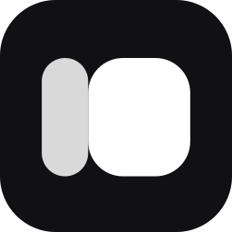

<div align="center">



# ShiftPane

**Your phone or tablet as a second monitor, sized to the device, with a live widget panel beside it.**<br />
Scan a QR code. No cable, no dummy plug, no app store.

[](https://github.com/kwiruu/shiftpane/actions/workflows/ci.yml)
[](https://github.com/kwiruu/shiftpane/releases/latest)
[](LICENSE)
[](https://shiftpane.vercel.app)

[Website](https://shiftpane.vercel.app) · [Widget gallery](https://shiftpane.vercel.app/widgets) · [Docs](https://shiftpane.vercel.app/docs) · [Download](https://github.com/kwiruu/shiftpane/releases/latest)

<br />


</div>

## What it does

- **Display mode.** The phone becomes a real extra monitor. The OS sees a new display sized to the phone, and you drag windows onto it, with text scaled to the size of the phone's own apps.
- **Widget board.** The phone shows widgets: the clock, calendar, what's playing and PC stats that come with the app, and any you install from the [gallery](https://shiftpane.vercel.app/widgets).
- **Split view.** Both at once. The split you pick is the resolution of the second monitor.
- **Make your own.** Widget Studio builds one without code, or from a sentence written by an open-weights model running on your PC; developers use the SDK and `shiftpane-widget`. Every widget is a small folder, checked and reviewed before the gallery lists it.

> **Status:** first release coming. Display mode, the widget board, split view, the marketplace, Widget Studio and per-monitor scaling work on Windows. The macOS and Linux virtual monitors are written and compile, but haven't been run on those systems yet.

## Packages for widget developers

The widget format is published to npm, so you can build, check and ship a widget without cloning this repo.

| Package | Install | What it is |
| --- | --- | --- |
| [`create-shiftpane-widget`](https://www.npmjs.com/package/create-shiftpane-widget) | `npm create shiftpane-widget@latest` | Starts a new widget from a template |
| [`shiftpane-widget`](https://www.npmjs.com/package/shiftpane-widget) | `npx shiftpane-widget dev` | CLI: `validate`, `dev`, `pack`, `login`, `publish` |
| [`@shiftpane/widget-sdk`](https://www.npmjs.com/package/@shiftpane/widget-sdk) | `npm i @shiftpane/widget-sdk` | The widget contract: manifest schema, `defineCollector` and the collector context |
| [`@shiftpane/widget-runtime`](https://www.npmjs.com/package/@shiftpane/widget-runtime) | `npm i @shiftpane/widget-runtime` | Runs collectors in a QuickJS sandbox with a guarded `fetch`; reads, checks and packs packages |

[](https://www.npmjs.com/package/create-shiftpane-widget)
[](https://www.npmjs.com/package/shiftpane-widget)
[](https://www.npmjs.com/package/@shiftpane/widget-sdk)
[](https://www.npmjs.com/package/@shiftpane/widget-runtime)

```sh
npm create shiftpane-widget@latest   # scaffold
npx shiftpane-widget dev             # live preview against your PC's readings
npx shiftpane-widget validate        # check the manifest, view and permissions
npx shiftpane-widget pack            # build the package
npx shiftpane-widget publish         # send it to the gallery for review
```

The [docs](https://shiftpane.vercel.app/docs) cover the manifest, views, sources and permissions. Widget Studio in the app (**Widgets → Make a widget**) makes the same packages without code.

## Repository layout

```text
apps/
  desktop/            Electron app: pairing, HTTPS + WebSocket server, capture, widget collectors
  phone/              PWA served by the desktop app: stream player, split view, widget panel, gallery
packages/
  protocol/           PC <-> phone WebSocket messages and pairing tokens (zod)
  layout/             Split-view math: phone size + split + pixel ratio -> monitor resolution
  board/              Widget board: tables of widgets, the built-in widgets and ViewWidget (React), for phone, desktop and the website
  widget-sdk/         The widget package format: manifest, view, sources, permissions (npm: @shiftpane/widget-sdk)
  widget-runtime/     Runs collectors in QuickJS with a guarded fetch; checks and packs packages (npm: @shiftpane/widget-runtime)
  widget-cli/         shiftpane-widget: validate, dev, pack, login, publish (npm)
  create-widget/      npm create shiftpane-widget: a new widget from a template (npm)
  helper-client/      Typed client for the native helper; types generated from Rust
  ui/                 Tailwind v4 design tokens and Solar icons shared by every app
native/
  crates/core/        Helper wire protocol, mode validation, DisplayBackend trait, request loop
  crates/windows/     Virtual Display Driver (IddCx), Win32 display control and scaling, PC readings
  crates/macos/       CGVirtualDisplay: in-process virtual monitor, no driver
  crates/linux/       Headless outputs on Sway and Hyprland, xrandr modes on X11
  crates/helper/      shiftpane-helper binary
.claude/              Project skills, plugins and the cloud-session setup hook
.github/workflows/    CI on every push; installers on version tags
```

The website, gallery and the API behind it are their own repository,
[kwiruu/shiftpane-market](https://github.com/kwiruu/shiftpane-market), live at
[shiftpane.vercel.app](https://shiftpane.vercel.app). It draws widgets with this repo's `board` and reads them with
its `widget-sdk`, copied in by its `pnpm sync:shiftpane`.

## How it fits together

```text
 phone (PWA) ──HTTPS / WebSocket (zod-validated)──▶ desktop app (Electron) ──stdin/stdout JSON──▶ shiftpane-helper (Rust)
      ▲                                                  │                                              │
      └────────────── WebRTC video (DTLS-SRTP) ──────────┘ captures only the virtual monitor            └─ creates and sizes it
```

The desktop app is the only process that talks to the phone, and the native helper is the only process that talks to OS display APIs.
Secrets and system access stay on the PC; the phone only ever receives video and finished widget data.

## Platform support

| | Windows | macOS | Linux |
| --- | --- | --- | --- |
| Virtual monitor | [Virtual Display Driver](https://github.com/VirtualDrivers/Virtual-Display-Driver) (user installs once: `winget install`, then Install in VDD Control) | `CGVirtualDisplay`, built in (macOS 11+); not yet run | Sway and Hyprland headless outputs, X11 with a spare output; not yet run. GNOME and KDE later |
| Monitor scale | Per monitor, matched to the phone | HiDPI (2x) | Per output on Sway and Hyprland |
| Widget board | ✓ | ✓ | ✓ |
| PC readings for widgets (CPU, GPU, media, ...) | ✓ | Later | Later |
| Installer | NSIS `.exe` | `.dmg` | AppImage, `.deb` |

## Tech stack


| Layer | Choice | Why |
| --- | --- | --- |
| Monorepo | pnpm workspaces + catalogs, Turborepo, Cargo workspace | One install, one version of each dependency, cached task graph across TS and Rust |
| Desktop | Electron 44 + electron-vite 5 + React 19 (React Compiler) | Per-display capture, hardware-encoded WebRTC and Node in one runtime on all three OSes |
| Phone | Vite + React 19 + Tailwind v4 + vite-plugin-pwa | One codebase for iPhone and Android, installable, no app store |
| Contracts | zod 4 (PC <-> phone), ts-rs (Rust -> TS for the helper) | Every boundary is typed on both sides and validated at runtime |
| Native helper | Rust 2024 edition, one crate per OS behind a shared trait | Direct OS APIs, one long-running process that keeps the virtual monitor alive, memory-safe |
| Lint and format | Biome 2, rustfmt, clippy (pedantic) | Fast, single tool per language |
| Types | TypeScript 7 (native compiler) | Strict mode, `noUncheckedIndexedAccess`; typechecks the whole repo in seconds |
| Tests | Vitest 5 + fast-check (property tests), `cargo test` | Core logic covered by example and property tests |
| Widget sandbox | QuickJS (WebAssembly) with a capped memory and a guarded `fetch` | Third-party collectors run with no file system, no processes, and only the hosts they declare |
| Widget generator | An open-weights model in [Ollama](https://ollama.com) on the user's PC (Qwen3 4B suggested) | Free, offline, nothing leaves the PC; the model fills in a schema-checked recipe, never code |
| Packaging | electron-builder 26, GitHub Actions | Installers for all three OSes from one tag |

Vite is held at 7 because electron-vite 5 does not support Vite 8 yet; move both when electron-vite 6 is stable.

## Getting started

Requirements: Node 22.12+, pnpm 10 (`corepack enable`), Rust stable (picked up from `rust-toolchain.toml`).

```sh
pnpm install
pnpm --filter @shiftpane/phone build   # the desktop app serves this build to phones
pnpm dev:desktop                        # Electron app; shows the pairing QR code
```

Scan the QR code with a phone on the same Wi-Fi. The phone warns about the self-signed certificate once; accept
it and the phone shows "Connected to <your PC>". If the PC has several network adapters (VPN, WSL, VirtualBox),
pick the one your phone is on from the Network menu under the QR code. `pnpm dev:phone` runs the phone UI alone
with hot reload, without pairing.

A paired phone keeps a key and reconnects on its own, across reloads and PC restarts, until it is forgotten on the
Devices page. ShiftPane added to an iPhone's home screen never sees the QR code's link (the camera opens it in Safari,
whose storage it does not share), so it asks for the six-digit code shown under the QR code instead.

| Command | What it does |
| --- | --- |
| `pnpm lint` | Biome over the whole repo |
| `pnpm format` | Biome with fixes applied |
| `pnpm typecheck` | `tsc` per package, `cargo check` for the native workspace |
| `pnpm test` | Vitest per package, `cargo test` (also regenerates the helper's TS bindings) |
| `pnpm build` | Production builds of every package |
| `pnpm package` | Phone build + release helper + installer for the current OS in `apps/desktop/release/` |
| `cargo run -p shiftpane-helper -- info` | Print this machine's virtual-display readiness |

Making a widget is covered under [Packages for widget developers](#packages-for-widget-developers).

## When a phone cannot open the pairing page

Both devices must be on a network that lets them communicate directly. Matching Wi-Fi names alone do not guarantee this: guest networks and client isolation can block local connections.

If the page loads nothing on the phone and no request reaches the PC for about 45 seconds, the Devices page says so and suggests the likeliest cause on home Wi-Fi: the router's AP or client isolation, which stops Wi-Fi devices from talking to each other. Turn that setting off, or use a phone hotspot.

Open **Phone won’t connect?** beside the QR code on Devices. Its separate test QR opens a tiny, script-free HTTPS page without pairing the phone. The PC reports whether another device requested the phone page, completed the test request, or reached the pairing connection. A missing request does not establish whether the cause is Wi-Fi isolation, a firewall, certificate handling, or another restriction. Local checks from the PC are excluded; observations are temporary and reset when the QR or selected network changes.

As a comparison test, enable Personal Hotspot and Allow Others to Join on the phone, connect the PC to it, and scan the updated main QR. ShiftPane checks adapter addresses every five seconds and refreshes its QR and certificate without restarting or dropping existing connections. If an address disappears, it chooses an available one; a manual adapter choice is kept while that address remains available. After temporary network loss, the QR returns automatically. A home-screen shortcut remains tied to its old network address and may need to be added again after switching networks.

## Working with Claude Code

`.claude/skills/` vendors skills for this stack (Electron, React 19, Tailwind 4, zod 4, Playwright, Rust, TDD, debugging);
see [.claude/skills/README.md](.claude/skills/README.md) for sources and licenses. Cloud sessions run `.claude/hooks/session-start.sh` to install dependencies.

## License

[MIT](LICENSE). Third-party projects are used as dependencies or references only; Virtual Display Driver is installed by the user and never bundled.
